# Matinbulle

Maquette web du réveil et de la routine matinale pensés pour le TDAH : trois écrans (réveil, routine, widgets), un fond qui glisse de la nuit à l'aube puis passe au jour après le réveil, une jauge de temps à trois niveaux et un arrêt par maintien de 1,5 s.

HTML, CSS et JavaScript sans build ni dépendance : `index.html`, `styles.css`, `app.js`, `logic.js`, `sounds.js`.

## Lancer en local

```bash
python3 -m http.server 8000
```

Puis ouvrir <http://localhost:8000>.

Rien à installer : pas de `npm install`, pas d'étape de compilation. Les scripts sont des modules ES (`type="module"`), donc il faut passer par un serveur HTTP — ouvrir `index.html` directement en `file://` ne chargerait rien.

## Vérifier

```bash
node check.mjs
```

Attendu : `checks ok — 41 tokens, ratios mesurés`, code de sortie 0. Node 18 ou plus, aucun paquet à installer.

`check.mjs` couvre trois familles de vérifications :

- **Logique** (`logic.js`, `sounds.js`) : jour de la semaine, prochain réveil (heure déjà passée, liste de jours vide), formats de durée, six étapes de routine = 31 min, vingt sonneries aux identifiants uniques dont aucune note ne dépasse la durée annoncée, rampé d'aube à cinq paliers sur 12 min avec interpolation continue et plafond, et les trois niveaux de temps (≥ 15 min « Large », 5–15 « On accélère », < 5 « C'est l'heure »).
- **Ratios WCAG AA** : le script relit les tokens de `styles.css`, recalcule le contraste de chaque paire texte/fond réellement utilisée et échoue dès qu'un ratio descend sous son seuil (texte principal de nuit ≥ 14:1, texte de jour ≥ 15:1, libellé du bouton principal ≥ 4,5:1, niveaux de temps ≥ 5,5:1, barres ≥ 3:1…). Changer une couleur sans revérifier casse donc le check.
- **Fuseaux et annonces** : décalages calculés pour `Europe/Paris` et `Asia/Tokyo` sur un instant donné, heure murale, prochain réveil selon le fuseau (07:15 le mercredi à Tokyo = 22:15 le mardi en UTC) et le passage à l'heure d'été du 29 mars 2026 (une heure volée : 4 h 45 au lieu de 5 h 45). Côté voix : synthèse `fr-FR`, annonce de début de première étape, de fin d'étape, de fin de routine, et présence du sélecteur de fuseau dans `index.html`.
- **Garde-fous du geste d'arrêt** : bouton de maintien présent, aucune étoile à toucher (`class="stars"` interdit), `HOLD_MS = 1500` dans `app.js`, et l'écran « Tu es debout. » avec une seule action, « Je suis levé ».

## Application Android

La même interface est empaquetée en APK natif (`android/`), sans Gradle ni Capacitor : `aapt2`, `javac`, `d8`, `zipalign`, `apksigner`. La page est embarquée dans `assets/www` et servie à la WebView sous `https://matinbulle.local`.

Téléchargement : [la dernière release](https://github.com/RABI46/matinbulle/releases/latest). Android demande d'autoriser l'installation depuis une source inconnue ; l'APK est signé avec une clé de debug locale, donc fait pour l'installation directe, pas pour le Play Store.

Ce que le natif ajoute à la page :

- le réveil est confié à `AlarmManager` (alarme exacte) et reprogrammé après un redémarrage de l'appareil, à l'heure du fuseau choisi dans la page ;
- `RingService` sonne la sonnerie d'alarme du système de bout en bout, vibre et affiche une notification plein écran : le son ne dépend pas de la page, donc balayer l'application pendant la sonnerie ne l'interrompt pas. Seul l'acquittement — maintien de 1,5 s ou action « Arrêter » — l'arrête, avec un plafond de cinq minutes ; relancé par le système après la mort du processus, il reprend la sonnerie tant que l'échéance n'est pas passée ;
- dans l'APK, la page ne joue pas sa propre sonnerie : les vingt sonneries synthétisées restent celles de la version navigateur ;
- sur Android 14, l'écran de réveil par-dessus le verrouillage exige la permission plein écran ; l'application propose de l'ouvrir au lancement, et sans elle le son et la notification restent intacts ;
- un réveil tombé pendant une extinction est signalé par une notification « réveil manqué » au démarrage ;
- les annonces vocales passent par le `TextToSpeech` du système (`android/bridge.js`), absent du WebView.

Reconstruire :

```bash
bash android/build.sh 1.0.1 8
```

Sortie : `android/build/Matinbulle-1.0.1.apk`.

## Régler le réveil

L'écran Réveil réunit tous les réglages : l'heure, les jours, le son, la montée du son, le fuseau horaire et les annonces vocales. Chaque changement est enregistré immédiatement dans `localStorage` (clé `matinbulle.v1`) et restauré au rechargement : rien à valider.

### Fuseau horaire

Le sélecteur propose le fuseau de l'appareil en tête, puis treize fuseaux courants : `Europe/Paris`, `Europe/London`, `Europe/Lisbon`, `Africa/Casablanca`, `Africa/Dakar`, `America/New_York`, `America/Toronto`, `America/Los_Angeles`, `America/Sao_Paulo`, `Asia/Tokyo`, `Asia/Shanghai`, `Australia/Sydney`, `Pacific/Auckland`. Le fuseau local est dédoublonné s'il figure déjà dans la liste.

L'heure du réveil est lue **dans ce fuseau** : 07:15 à Paris et 07:15 à Tokyo sont deux instants différents. Sous le sélecteur, « Il est 12:54 · UTC+01:00 » donne l'heure murale et le décalage en vigueur à cet instant. Le compte à rebours, l'heure du prochain réveil, l'en-tête du jour et les widgets suivent tous ce fuseau.

Le changement d'heure est pris en compte : `nextAlarmInZone` sépare l'heure murale (pour l'affichage) de l'instant réel (pour le compte à rebours), donc une nuit de passage à l'heure d'été affiche bien 07:15 et un compte à rebours raccourci d'une heure.

### Annonces vocales

Chaque étape est annoncée à voix haute par `speechSynthesis`, en français (`fr-FR`, voix française choisie si le navigateur en propose une) :

- **début d'étape** — « Étape 1 sur 6 : Se lever. Une minute. » ;
- **fin d'étape** — « Se lever : c'est terminé. », dite quand le minuteur arrive à zéro, ou juste avant de passer à l'étape suivante si on avance à la main (l'annonce de fin et celle de début sont alors enchaînées) ;
- **fin de routine** — « Routine terminée. Bonne journée. », après la dernière étape.

L'interrupteur « Annonces vocales » coupe la voix immédiatement, et « Recommencer » interrompt l'annonce en cours. Sans synthèse vocale disponible, la maquette reste utilisable : les annonces sont simplement muettes.

## Tokens couleur

Extrait de `:root` dans `styles.css` (la liste complète, 41 tokens, est dans le fichier) :

| token | valeur | usage |
| --- | --- | --- |
| `--nuit-900` | `#14181D` | fond de nuit |
| `--nuit-800` | `#1B2026` | carte de nuit |
| `--aube-800` | `#5A3A29` | palier 9 min, widget Défi |
| `--aube-700` | `#6E4630` | dernier palier d'aube |
| `--ambre-400` | `#F2C078` | heure et accents de nuit |
| `--creme-nuit` | `#F4E9DE` | texte de nuit |
| `--jour-50` | `#FBF6EE` | fond de jour |
| `--carte` | `#FFFCF7` | carte de jour |
| `--encre-900` | `#241F1B` | texte de jour |
| `--action-jour` | `#C2410C` | seule couleur d'action, jour |
| `--action-nuit` | `#F2A24E` | seule couleur d'action, nuit |
| `--temps-large` | `#33543E` | niveau « Large » |
| `--temps-presse` | `#6B4A08` | niveau « On accélère » |
| `--temps-partir` | `#8C3A26` | niveau « C'est l'heure » |
| `--temps-large-nuit` | `#7FB08D` | « Large » sur fond nuit |
| `--temps-presse-nuit` | `#E3B24B` | « On accélère » sur fond nuit |
| `--temps-partir-nuit` | `#F08A6A` | « C'est l'heure » sur fond nuit |

Un niveau de temps est toujours doublé d'un mot : la couleur ne porte jamais l'information seule.

## Captures

Les 17 captures de `shots/` ont été prises pendant la vérification, une par état d'écran. Elles ne sont pas chargées par la maquette : ce sont des documents, pas des ressources.

### Nuit et aube

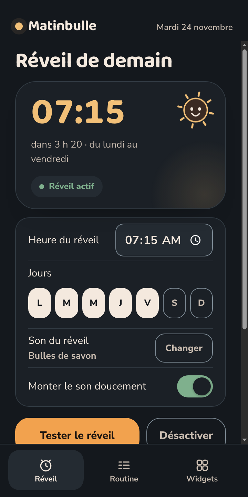
Écran de veille sur fond de nuit : heure en ambre, jauge « Large ».

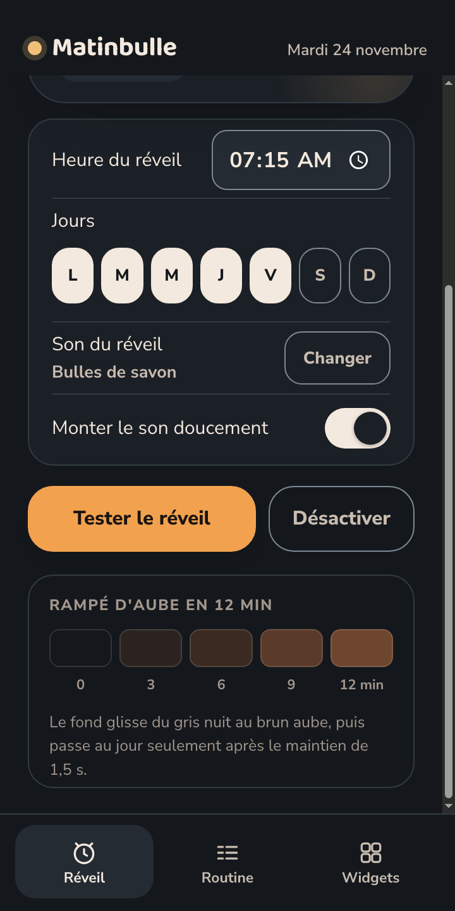
Le même écran pendant le rampé d'aube — le fond glisse vers les paliers chauds.

### Réveil et sonnerie

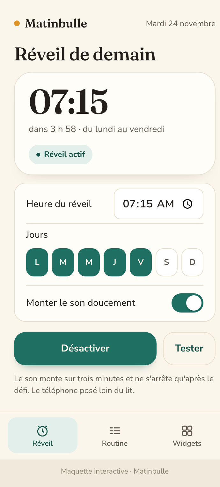
Écran de réveil : heure, prochain réveil et accès aux routines.

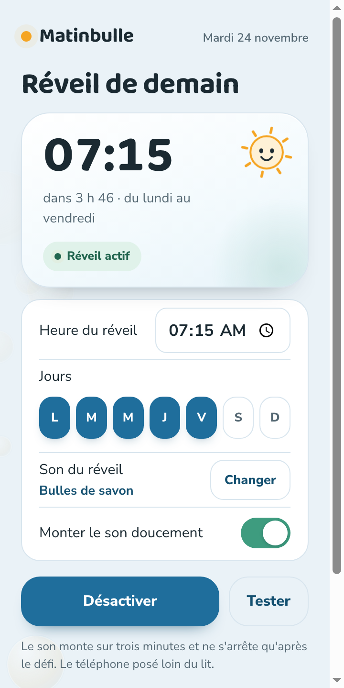
Réveil, état suivant : le compte à rebours a avancé, la jauge a changé de niveau.

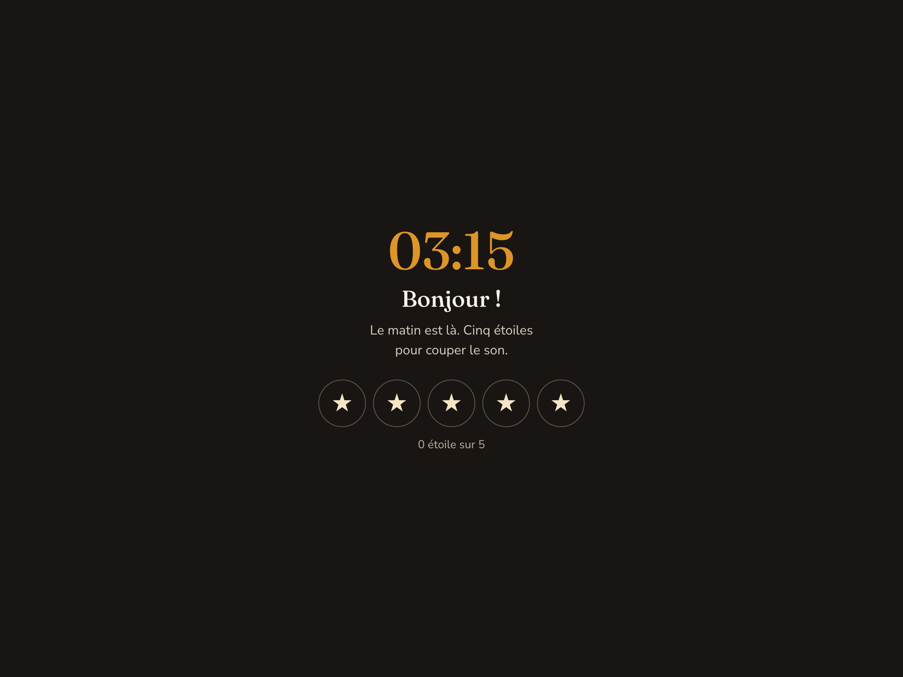
Sonnerie en cours : une seule action, le bouton de maintien.


Maintien en cours : l'anneau se remplit pendant les 1,5 s du geste d'arrêt.

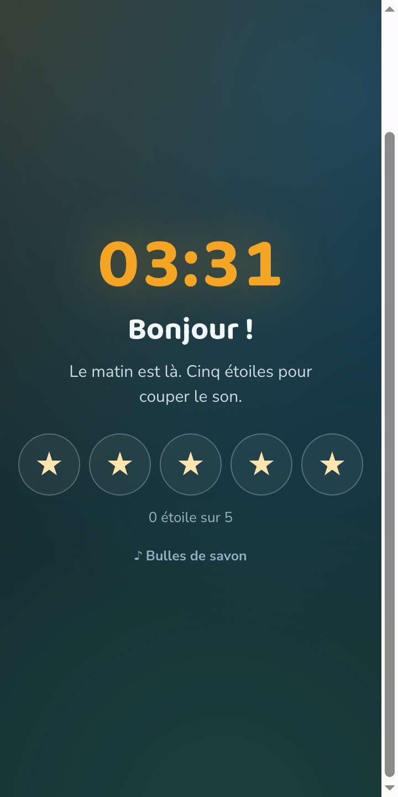
Même écran de sonnerie avec une autre sonnerie sélectionnée.

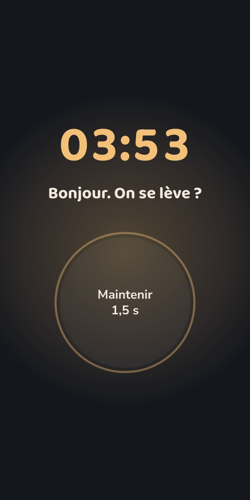
Sonnerie déclenchée au moment de l'aube, fond encore chaud.

### Routine et debout

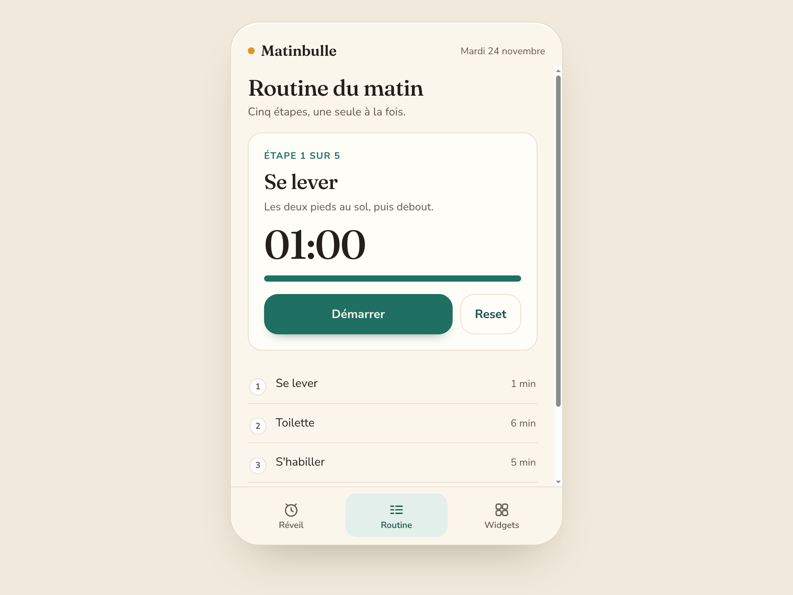
Routine matinale : les six étapes, 31 min au total.

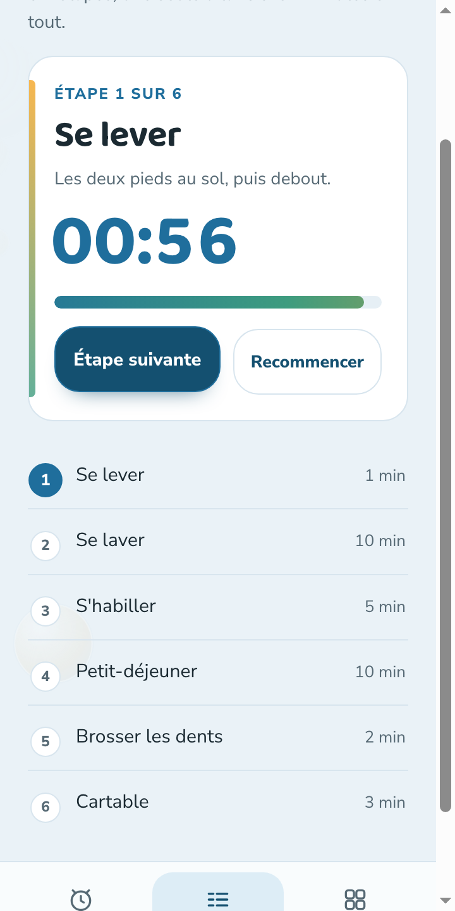
Routine à l'étape suivante, avec la jauge de temps mise à jour.

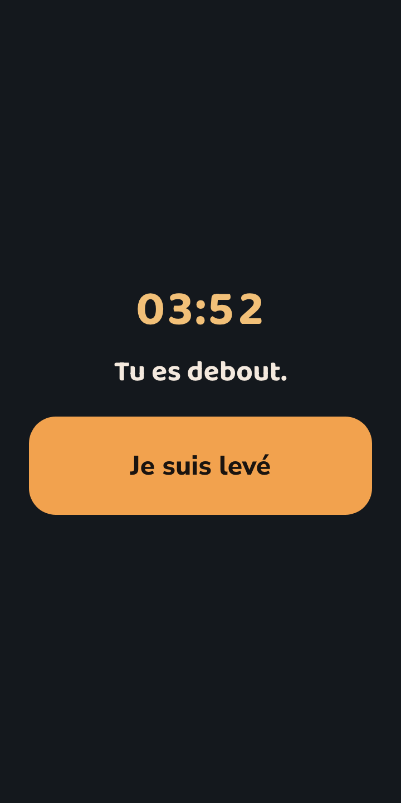
Écran « Tu es debout. » : une seule action, « Je suis levé ».

### Widgets

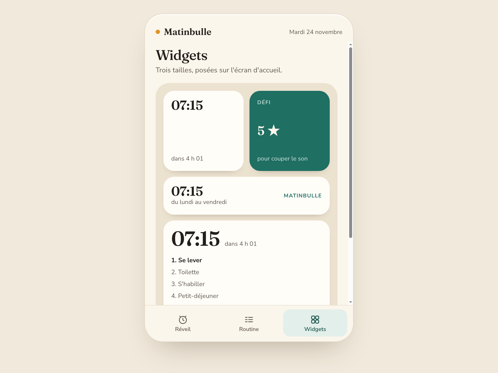
Écran des widgets : défi, météo du matin et rappel de la routine.

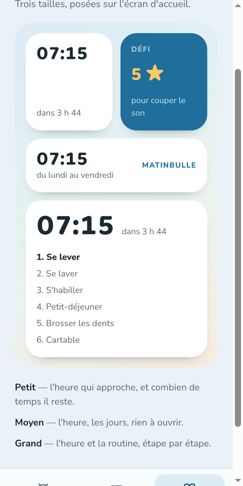
Widgets dans un autre état, après interaction.

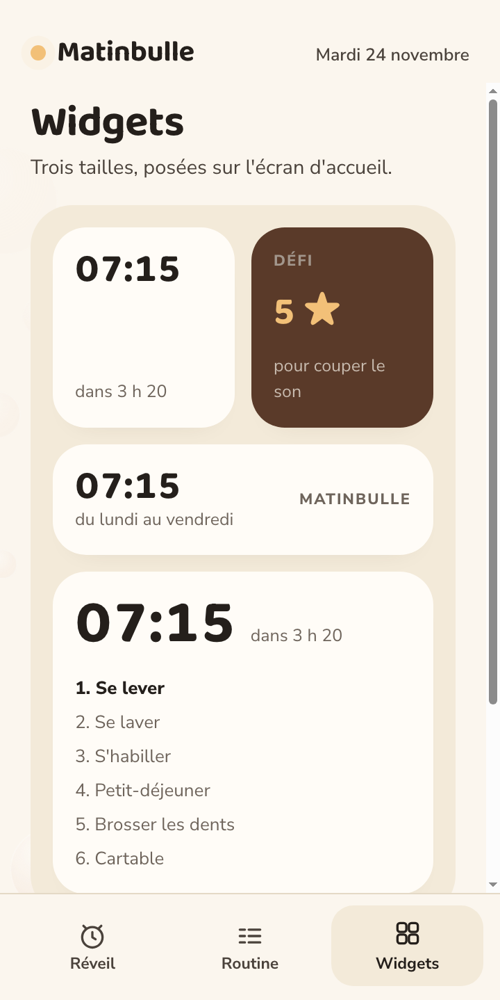
Les mêmes widgets sur le fond de jour.

### Thème jour

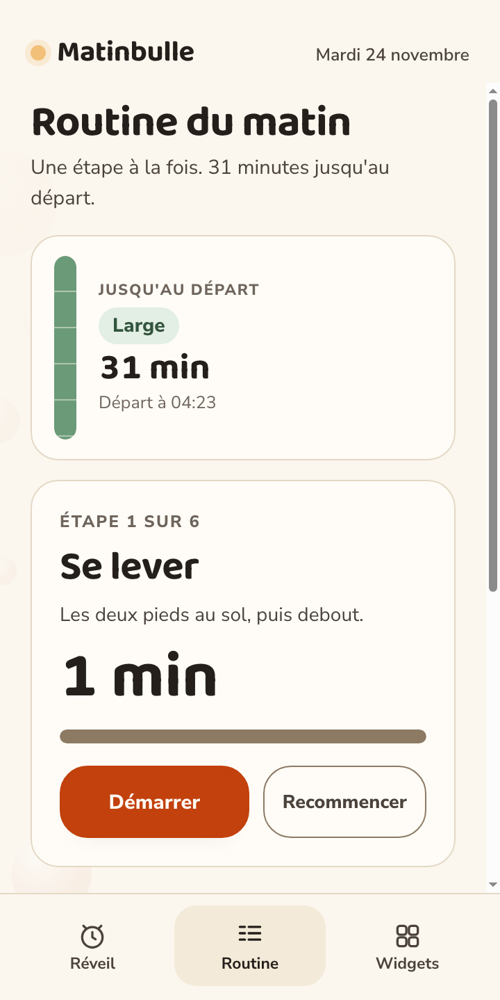
Thème jour : la jauge à trois niveaux sur fond clair.

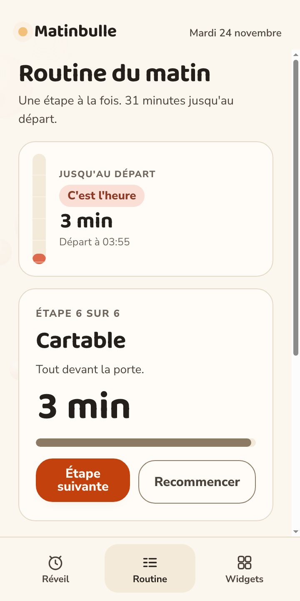
Thème jour au niveau « C'est l'heure » — couleur et mot, jamais la couleur seule.

### Sonneries

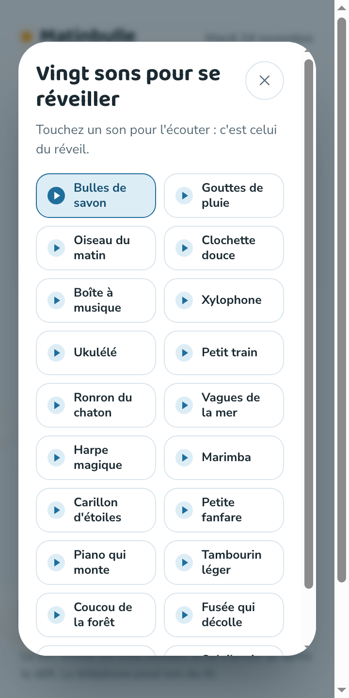
Choix parmi les vingt sonneries synthétisées.
